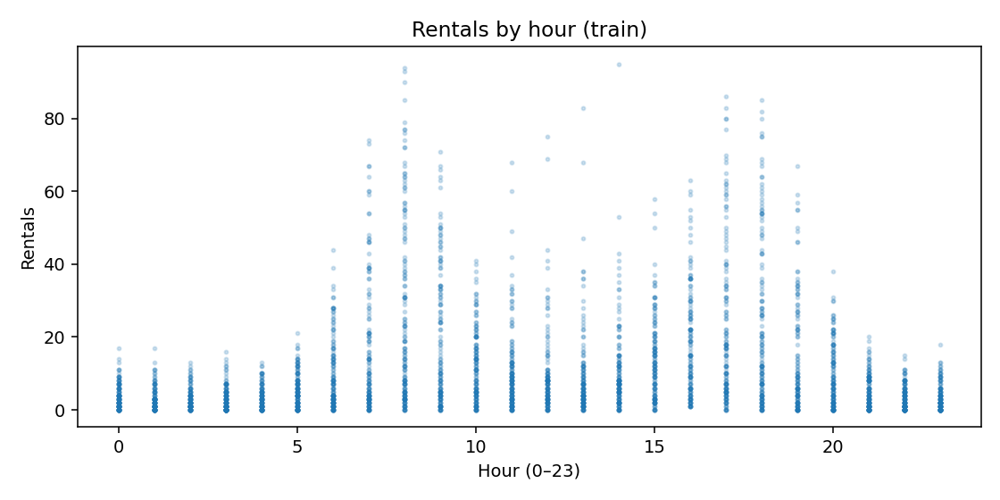
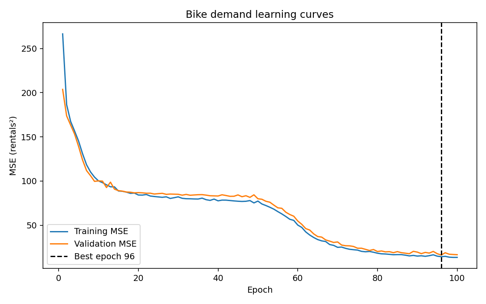

# Lakeshore Bike Demand

## What it does

This project predicts the number of bikes rented from a Lakeshore Bike Share station
in an upcoming hour, using simulated station-hour data supplied in Lab 07. It
implements a training loop **by hand**, compares a neural network with a
training-mean predictor and ordinary linear regression, and records learning curves
and controlled experiments. It is a learning exercise, not a production demand forecast.

## How to run it

From the repository root (Python 3.12, CPU-only execution is sufficient):

```bash
conda env create -f environment.yml
conda activate lab07-first-principles
python bikes_data.py
python train.py
python -m ruff format --check .
python -m ruff check .
python -m pytest
```

`python train.py` rebuilds **all** PNG, CSV and JSON reports from the supplied
simulated data. To apply automated format changes if required, run
`python -m ruff format .`, and then repeat the three checks. No web connection or
Hugging Face deployment is required to execute the project once dependencies are installed.

## Data and split

The supplied `bikes_data.py` generates 6,000 reproducible synthetic examples using
seed **2026**. Each row has `hour`, `temperature_c`, `rain_mm`, `wind_kph`,
`is_weekend`, `station_type`, and the target `rentals`. Its Python statements
follow the handout's provided data-generating recipe; PDF-derived indentation
was normalized so that the given code is executable (the dataset-generating
logic and values were not changed).

Rows are split **before** preparation: **3,600 train (60%), 1,200 validation
(20%), 1,200 held-out test (20%)**. The `StandardScaler` and `OneHotEncoder` are
fitted only on training rows; validation and test are transformed without a refit.
The custom `BikeDataset` yields `(features, target)` as float32 tensors with
shapes `(8,)` and `(1,)` per sample. Only the training DataLoader shuffles;
its random generator is seeded. The test split is reserved until model selection
is complete.



The rental relationship with hour is **not a straight line**. There are
weekday commute peaks and a different weekend/park midday profile, with
weather and station type interactions. A linear model on raw hour and the
other encoded inputs cannot capture these bends and interactions very well.

## Model and training

`BikeNet` is a manually defined `torch.nn.Module` with **two hidden ReLU
layers** and one unactivated regression output; no trainer/`.fit()` API is
used for the neural network. The main run has **64 hidden units per layer**,
MSE loss, Adam optimization at **0.003**, **batch size 128**, and **100 epochs**.
Each epoch explicitly calls `optimizer.zero_grad()`, `loss.backward()` and
`optimizer.step()`, and records per-observation training loss, training MAE,
validation loss, and validation MAE. The weights from the minimum validation
MSE epoch are restored after training.

Three runs use the same fixed split and seed. The **low-learning-rate** run
changes only learning rate to **0.00003**. The **wide-network** run changes
only hidden width to **256**. Before *any* test evaluation, the final model is
chosen by the **lowest validation MSE across the three runs**. The test set is
then evaluated once, at the end, on the selected network and two baselines.
The data preparation, parameters and plotting methods are seeded/deterministic
on the reference CPU; very small floating-point differences across machines
are possible.

## Results

The following measured MAEs are in **bikes rented per hour** (lower is better):

| Model | Validation MAE (rentals) | Test MAE (rentals) |
|---|---:|---:|
| Training-set mean baseline | 9.952 | 9.848 |
| Linear regression baseline | 9.032 | 8.763 |
| **Validation-selected neural network (wide-network)** | **2.455** | **2.423** |

The neural network is better than both baselines on the held-out test data.
The mean predictor ignores the inputs. The linear regression is more useful
than the mean but cannot model the pronounced hour-of-day peaks and
weather/station interactions seen in the hour scatter plot. The better network
captures nonlinear behavior, but does not guarantee real-world accuracy.

**Main run learning curves:**



The main network reduces both train and validation loss, and its best
validation epoch is **96**. The difference between the final and best
validation loss indicates that late training is not uniformly improving
validation fit. The dashed line marks the best checkpoint, not the last epoch.

## Experiments

| Run (single changed setting) | Best epoch | Best validation MAE | Final training MSE | Final validation MSE |
|---|---:|---:|---:|---:|
| Main: width 64, lr 0.003 | 96 | 2.74 | 13.713 | 16.844 |
| Low learning rate: lr 0.00003 | 100 | 9.061 | 185.189 | 186.230 |
| Wide network: width 256 | 36 | 2.455 | 8.610 | 14.675 |

- **Main:** Healthy learning with modest generalization gap. The best
  validation loss precedes the end, showing small late fluctuations or early
  overfitting. See `reports/learning_curves.png`.
- **Low learning rate:** Severe **underfitting** in the fixed epoch budget:
  both losses remain high and are still falling at epoch 100. This is slow
  optimization, not proof that a smaller learning rate is fundamentally worse.
  See `reports/curves_low_learning_rate.png`.
- **Wide network:** Learns more quickly and reaches the best validation MAE;
  its best epoch is early (36). Training keeps reducing MSE while final
  validation MSE is worse than its best, consistent with **overfitting after
  the best checkpoint**. Best weights are restored. See
  `reports/curves_wide_network.png`.

Data tables and full epoch logs are in `reports/experiments.csv`,
`reports/history.csv`, and `reports/history_<run>.csv`. Reproduction summary
(including the single held-out test result) is `reports/metrics.json`.

## Limitations

- Data are **invented** by a known simulation. They do not represent real
  riders, stations, cities, holidays, or demand shocks.
- The model cannot see the number of available bikes/docks, nearby events,
  operational incidents, forecast errors or longer-term demand patterns.
- Its regression head can predict **negative or fractional numbers**, even
  though true rentals are nonnegative integers; downstream systems would
  need carefully justified post-processing.
- The split is a seeded random split of synthetic rows, not a realistic
  future-time or new-station generalization test.
- Planners should not use these results alone to determine actual staff
  allocation, bike transfers, safety or service-level decisions.
- Experiments illustrate learning behavior, not an exhaustive tuning search.
  More tests on independent real-world data would be necessary before use.


### Refer to `SETUP_AND_SUBMISSION.md` for exact Git/Conda/VS Code steps.
